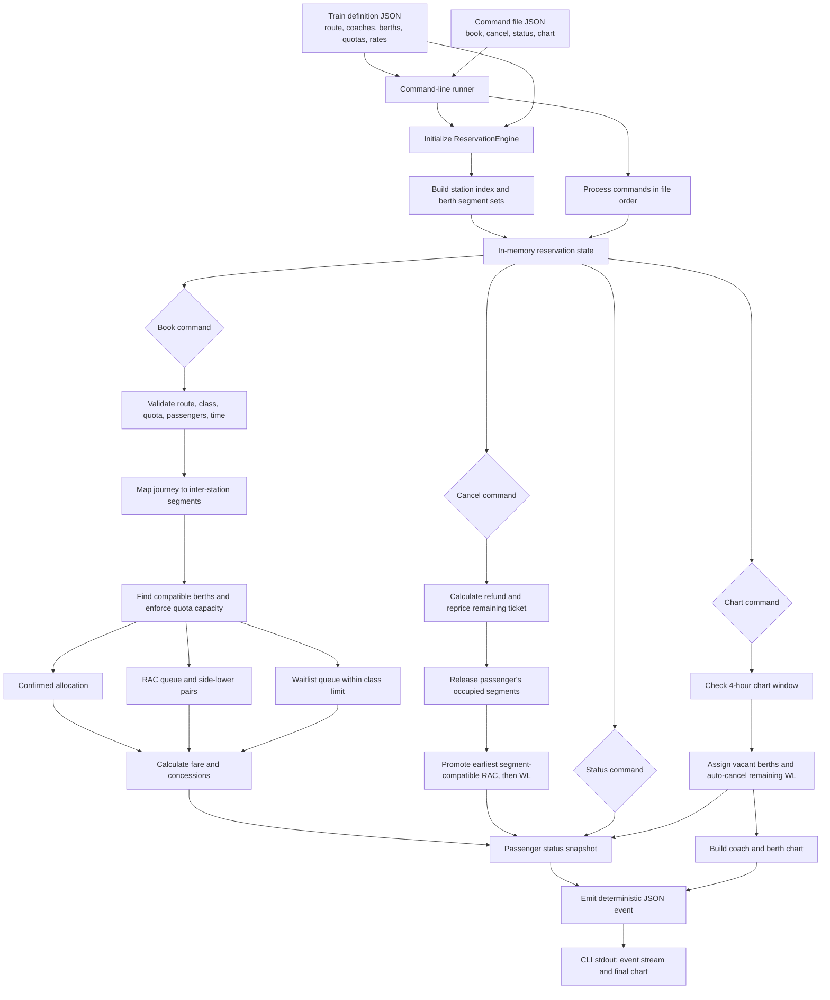

# Reservation Engine Data Flow

The engine uses route-edge sets per berth: a journey from station index `i` to `j` occupies edges `[i, j)`. Allocation, cancellation, and promotion all consult this same segment model, so partial-route bookings can reuse a berth when their occupied edges do not overlap.

