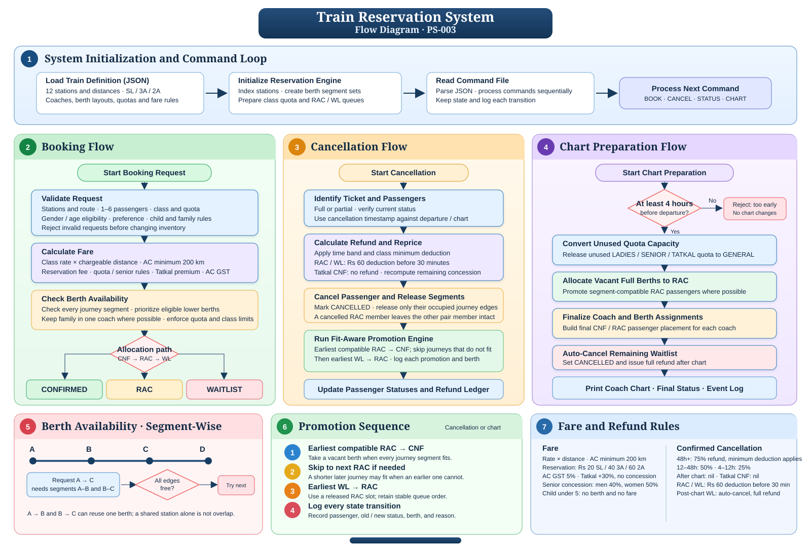

# Reservation System Flow Diagram

The diagram follows the command-file lifecycle: initialize the train and berth data, process booking / cancellation / chart commands, and emit passenger status snapshots and the final coach chart. The lower panels explain segment-wise berth availability, the fit-aware promotion sequence, and fare / refund rules.

The editable vector source is [reservation-flow.svg](reservation-flow.svg). The berth occupancy model uses route edges `[i, j)` for a journey from station index `i` to `j`, so adjacent trips such as A → B and B → C can reuse a berth.

